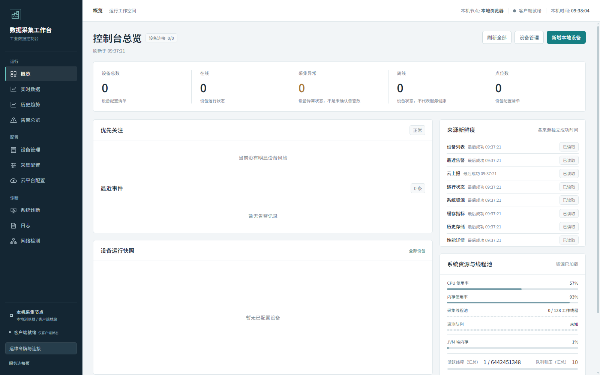
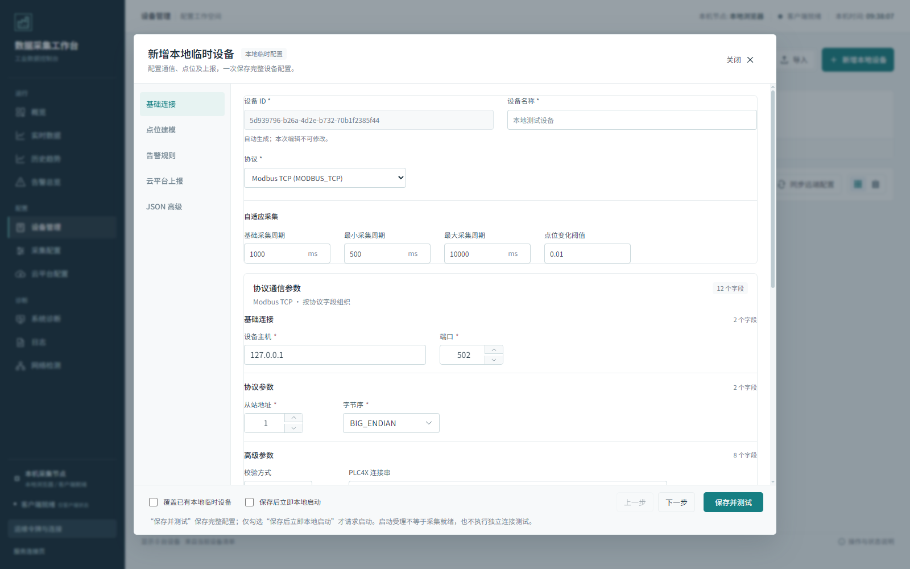
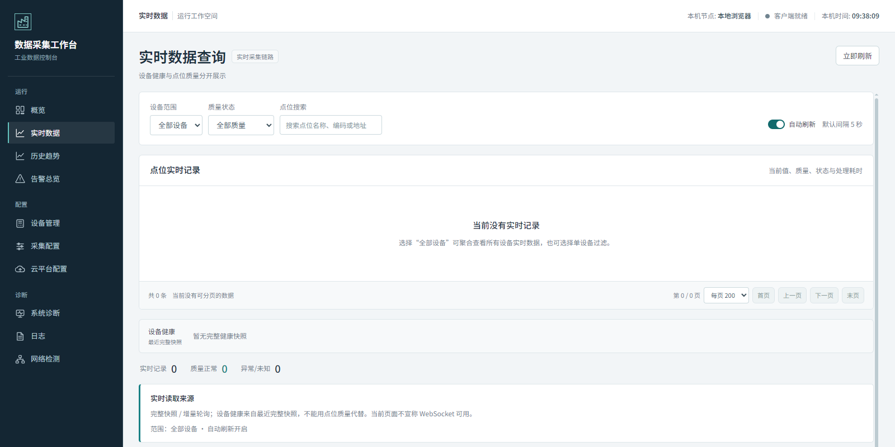
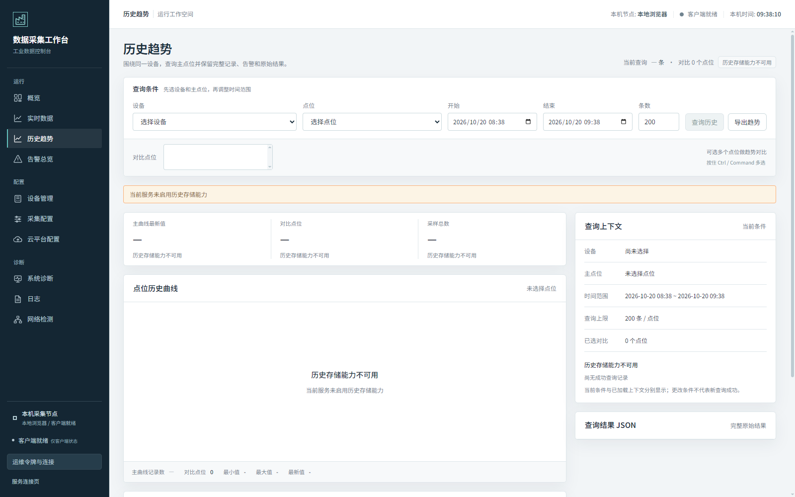
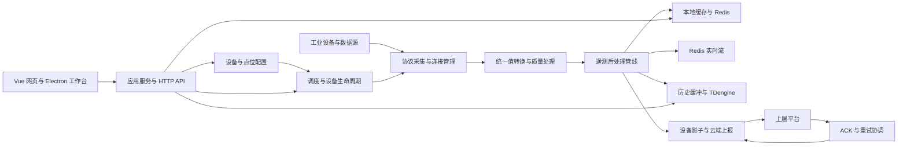

<p align="center">
  
</p>

<h1 align="center">工业多协议数据采集网关与可视化工作台</h1>

<p align="center">连接工业设备，统一采集处理，在同一工作台中完成配置、观测与运维。</p>

<p align="center">
  
  
  
  <a href="./LICENSE"></a>
</p>

<p align="center">
  <a href="#项目简介">项目简介</a> ·
  <a href="#界面预览">界面预览</a> ·
  <a href="#快速开始">快速开始</a> ·
  <a href="#协议支持">协议支持</a> ·
  <a href="#系统架构">系统架构</a> ·
  <a href="#参与贡献">参与贡献</a>
</p>

## 项目简介

**data-collection-service** 是一个面向工业物联网的多协议数据采集网关。它将不同设备的连接、点位和采集结果纳入统一链路，提供采集调度、数据转换与质量处理、本地与 Redis 缓存、历史存储、云端上报及运行监控能力。

项目同时提供 **浏览器工作台** 和 **Electron 桌面客户端**，共用一套 Vue 界面。后端采用 Maven 多模块结构，但最终部署的是一个 Spring Boot 可执行 JAR，不需要将这些模块分别部署成微服务。

### 适用场景

- **工业现场采集**：在同一网关中接入 PLC、仪表、楼宇设备及其他数据源。
- **异构系统集成**：统一处理不同协议的数据，再对接历史存储或上层平台。
- **私有化部署**：通过浏览器或桌面客户端管理独立部署的采集服务。
- **二次开发**：在现有协议抽象、调度与遥测处理链路上扩展设备接入能力。

### 核心特性

| 能力 | 可以做什么 |
| --- | --- |
| **多协议接入** | 接入 Modbus、S7、OPC UA、BACnet、IEC、MQTT 等协议；按协议能力使用轮询、推送或订阅。 |
| **可视化配置** | 管理设备、连接和点位，使用协议 Schema 动态表单、配置导入导出与差异诊断。 |
| **采集与质量处理** | 使用时间片调度、批量读计划、值转换和质量判定，区分连接状态与有效采集状态。 |
| **实时与历史数据** | 查询当前点位值、质量和状态；启用 TDengine 后查询历史记录和对比趋势。 |
| **云端集成** | 按配置使用 MQTT、HTTP、TCP 上报，配合设备影子、Outbox、ACK 与重试机制管理上报状态。 |
| **运行运维** | 查看告警、系统资源、运行日志、链路诊断和受限网络检测结果。 |

> 协议能力与外部服务依赖并不完全相同。请结合下方的[协议支持](#协议支持)、[部署与配置](#部署与配置)和[当前状态与限制](#当前状态与限制)选择实际使用范围。

## 界面预览

以下截图来自当前 Vue 工作台在**隔离本地实例**中的实际运行界面，不是设计稿。取图时未接入设备，也未启用历史存储，因此保留了真实空态和未启用提示；设备配置图为未保存的编辑表单。截图仅展示界面，不代表协议互操作或性能验收结果。部分页面按展示主题裁切，可点击截图查看大图。

### 运行总览

集中查看设备运行摘要、运行快照与各数据来源的新鲜度。

[](./images/console-overview.png)

<details>
<summary><strong>设备配置：协议字段、点位建模与上报配置</strong></summary>

根据协议 Schema 展示连接参数，并在同一编辑器中组织点位、告警和上报配置。图中表单尚未保存。

[](./images/device-configuration.png)

</details>

<details>
<summary><strong>实时数据：设备健康与点位质量</strong></summary>

按设备范围、质量状态和点位关键词查看实时记录；未接入设备时明确显示无记录。

[](./images/realtime-data.png)

</details>

<details>
<summary><strong>历史趋势：查询、对比与完整记录</strong></summary>

围绕设备和点位组织时间范围、趋势对比、历史表格与相关告警。图中服务未启用历史存储，不包含虚构曲线。

[](./images/history-trend.png)

</details>

## 快速开始

### 1. 准备环境

以下命令均在仓库根目录执行。

| 工具 | 用途与要求 |
| --- | --- |
| **Java 17** | 运行与构建后端。 |
| **Maven** | 构建 Maven 多模块工程，建议使用 3.9 系列。 |
| **Node.js / npm** | 构建 Vue 界面与桌面客户端；版本需满足前端锁文件中的依赖引擎要求。 |
| **设备或协议服务端** | 实际采集数据时需要；仅预览工作台不需要。 |

Redis、TDengine 和云端服务按启用的功能配置，不是下面本地界面预览路径的前提。

### 2. 构建网页控制台和后端

```bash
npm --prefix collector-desktop ci
npm --prefix collector-desktop run build:web
mvn -B -ntp -pl collector-boot -am package -DskipTests
```

- `build:web` 构建 Vue 界面，并同步到 `collector-boot/src/main/resources/static/desktop/`。
- 后端产物为 `collector-boot/target/data-collection-service-0.0.1-SNAPSHOT.jar`。
- `-DskipTests` 仅用于此处的构建路径，不表示任何测试或现场验收已经完成。
- Windows Git Bash 如遇 Maven 启动器问题，可在 CMD / PowerShell 中执行相同的 Maven 命令。

### 3. 配置本地预览并启动

首次体验建议使用独立本地配置，避免直接连接现有远程配置源或云平台。

在本机创建 `collector-local.yml`，填入下方配置。**将 `[REDACTED]` 替换为你自己的强随机运维令牌**；它只是占位符，不是可直接使用的默认令牌。不要将填入真实凭据的配置文件提交到仓库。

<details>
<summary><strong>展开本地预览配置：本地缓存，不连接远端配置、历史库或云上报</strong></summary>

```yaml
server:
  address: 127.0.0.1
  port: 9090
  servlet:
    context-path: /collector
spring:
  autoconfigure:
    exclude:
      - org.springframework.boot.autoconfigure.jdbc.DataSourceAutoConfiguration
      - org.mybatis.spring.boot.autoconfigure.MybatisAutoConfiguration
  data:
    redis:
      stream:
        enabled: false
collector:
  auth:
    enabled: true
    ops-tokens:
      "[REDACTED]": local-operator
  config:
    loader: file
    local-device-snapshot-file: ./data/local-device-configs.json
  cache:
    type: local
  telemetry-ingress-buffer:
    enabled: false
  alarm:
    state:
      enabled: false
  report:
    enabled: false
    mqtt:
      enabled: false
    shadow:
      persistence-enabled: false
      history-enabled: false
telemetry:
  tdengine:
    enabled: false
management:
  health:
    redis:
      enabled: false
    db:
      enabled: false
```

这是仅绑定本机地址的最小体验配置，不是生产部署模板。它关闭了 Redis 相关缓冲、历史存储和云端上报；未设置文件设备清单时，界面从空设备配置开始。不要删除鉴权开关来绕过令牌配置。

</details>

```bash
java -jar collector-boot/target/data-collection-service-0.0.1-SNAPSHOT.jar --spring.config.location=file:./collector-local.yml
```

打开浏览器访问：

```text
http://127.0.0.1:9090/collector/desktop/index.html#/login
```

在连接页填写服务地址 `http://127.0.0.1:9090/collector` 和刚配置的运维令牌，再进入工作台。公共健康检查入口为 `http://127.0.0.1:9090/collector/health`；业务健康仍需结合其响应内容与实际采集状态判断。

### 4. 接入第一台设备

1. 进入 **设备管理**，选择 **新增本地设备**。
2. 选择协议，填写真实设备地址、连接参数和设备名称。
3. 在 **点位建模** 中配置实际地址、数据类型、采集周期等字段。
4. 不使用云端上报时关闭相应选项，核对必填项后保存。
5. 显式启动目标设备；如使用“保存后立即本地启动”，分别检查保存与启动结果。
6. 在 **实时数据** 中检查当前值、质量和采集状态，而不只看“在线”或“启动已受理”。

应用启动不会自动启动全部已配置设备。没有设备、协议服务端或有效点位时，界面不会产生采集数据。

需要本地协议环境时，可参考仓库已有的[协议仿真器说明](./tools/protocol-simulators/README.md)；仿真联调不等同于目标设备互操作验证。

## 协议支持

下表概括当前代码与协议元数据所表达的能力。**已有实现不等于完整标准实现，也不等于所有厂商设备均已验证。** 写入、订阅和浏览等单项能力应以运行时协议 Schema 与目标设备为准。

| 分类 | 协议 | 当前实现与主要边界 |
| --- | --- | --- |
| 工业通用 | **Modbus TCP / RTU / ASCII** | 寄存器与线圈读写、批量读计划；ASCII 通过 RTU 家族兼容接入。 |
| PLC | **Siemens S7** | `DB / I / Q / M` 地址读写；订阅能力依赖实际驱动与运行环境。 |
| PLC | **Mitsubishi MC** | 自研 MC 3E Binary over TCP 读写；目标 PLC 地址与帧兼容性仍需验证。 |
| PLC | **OMRON FINS** | FINS/UDP、FINS/TCP 轮询读写及连续块合并；按实际传输方式配置。 |
| PLC | **EtherNet/IP** | Logix 受限标量读写；`Program:` 命名空间标量仅只读，数组当前不可用。 |
| PLC / 楼宇 | **ADS / KNXnet/IP** | ADS 符号读写、KNX 组地址与 DPT 类型映射；订阅取决于运行环境。 |
| OPC | **OPC UA / OPC_UA_PLC4X** | 默认 `OPC_UA` 使用 Eclipse Milo；保留 PLC4X 接入标识。订阅与浏览依赖服务端及驱动条件。 |
| OPC | **OPC DA** | 通过外部 HTTP 桥接服务接入，也有内存桥模式；不是内置原生 DCOM 客户端。 |
| 楼宇 | **BACnet/IP / MS/TP** | 属性读写与运行依赖型订阅；需对应网络或串口环境。 |
| 电力 | **IEC104** | 常用遥信、遥测、电度、召唤和控制路径，不承诺完整 IEC 60870-5-104 标准能力。 |
| 电力 | **IEC61850** | MMS 客户端、模型加载、常见属性读写与 Report 入口；复杂模型、RCB/Dataset 及 IED 互操作需验证。 |
| 物联网 | **MQTT / SNMP / CoAP** | 主题映射、GET/SET/WALK、请求与 Observe 等按各协议能力提供；不将所有协议视为同一能力集合。 |
| 网络接口 | **HTTP / WebSocket** | HTTP 请求响应采集、WebSocket 消息接入；提供相应安全传输变体。 |
| 实验性 | **OPC_UA_MILO / BACnet/SC** | 显式 `OPC_UA_MILO` 标识仍按实验性元数据提供；BACnet/SC 当前为实验性 WSS 隧道，未建立标准 Hub/Node 会话。 |
| 实验性 | **IEC101 / DL/T 645-2007** | IEC101 为非平衡控制站侧能力；电表与 RTU 型号、串口环境及写入行为需目标设备验证。 |
| 实验性 | **Custom TCP / UDP** | 受控请求响应、帧边界和数据解析；需按实际厂商报文联调，不是任意私有协议的自动适配。 |

连接字段、点位字段和能力状态由后端 `ProtocolDescriptorProvider` 汇聚，工作台按 Schema 展示动态表单。协议别名和安全传输变体不应重复统计为独立的设备兼容性成果。

## 系统架构



- **采集协议与后处理分离**：协议实现不自行维护另一套缓存、历史存储或云上报链路。
- **本地身份与云端身份分离**：本地设备 ID 用于采集和运行状态，云平台身份在上报边界映射。
- **发送与确认分离**：消息发送成功、平台 ACK 和影子提交不是同一状态。
- **模块化单体部署**：工程按职责分模块，运行时仍由一个后端服务提供能力。

## 部署与配置

### 两种工作台入口

| 方式 | 使用方法 | 边界 |
| --- | --- | --- |
| **浏览器工作台** | 将 Vue 构建产物打入后端 JAR，访问 `/collector/desktop/index.html`。 | 默认本地配置仅监听 loopback；对外提供服务前需设置监听地址、网络防护、TLS 与鉴权。 |
| **Electron 桌面客户端** | 启动客户端，连接独立运行的后端服务。 | 不内置 JRE、不自动启动或管理后端 JAR；当前打包配置面向 Windows。 |

### 按功能启用依赖

| 功能 | 需要关注的配置与依赖 |
| --- | --- |
| 设备配置来源 | `collector.config.loader=file` 使用文件源；`remote` 使用远程配置源。文件源分别配置设备清单、点位目录与连接目录。 |
| 本地设备配置 | 工作台保存的本地设备由磁盘快照保存；用 `collector.config.local-device-snapshot-file` 指定路径并保障写入权限与备份。 |
| 多级缓存与实时流 | 配置 Redis；实时流由 `spring.data.redis.stream.enabled` 控制。实时流不是跨故障可靠恢复队列。 |
| 历史数据与趋势 | 启用 `telemetry.tdengine.enabled` 并配置 TDengine 数据源；可靠写入恢复还需考虑 Redis 与本地退化队列。 |
| 云端上报与 ACK | 配置 `collector.report` 下的通道、目标身份与提交策略；持久化影子、Outbox 等能力需要相应存储。 |
| 告警与运行监控 | 分别配置告警状态、历史存储与日志；接口可达、设备连接和采集健康不能相互替代。 |

本地设备快照默认位于 `${user.home}/.data-collection-service/local-device-configs.json`。它与文件配置源不是同一个文件；配置被保存不代表设备会在下次启动时自动开始采集。

**完整部署不能直接照搬最小预览配置。** 启用历史存储时应移除预览配置中的数据源自动装配排除项，配置实际 TDengine 连接；启用 Redis 支路与云上报时也需恢复对应开关，并验证完整数据链路。仓库中的开发配置不能直接视作生产模板。

### 访问与安全

- 网页静态资源和公共健康检查默认可访问；业务 API 与监控接口需要鉴权。
- 运维访问使用 `X-Collector-Token`；`collector.auth.ops-tokens` 的映射方向是 **令牌 → 描述**。
- 真实令牌、设备密钥、数据库凭据与云平台凭据应通过受控外部配置或环境注入，不写入 README、截图或日志。
- 对外部署应配置访问控制和 TLS；不要以关闭鉴权或跳过证书校验的方式解决部署问题。

<details>
<summary><strong>构建与交付命令：网页资源同步、前端开发与 Windows 桌面打包</strong></summary>

只构建并同步网页资源：

```bash
npm --prefix collector-desktop run build:renderer
npm --prefix collector-desktop run sync:web
```

同步脚本会先清空后端旧静态资源目录，再复制最新构建结果，避免残留旧 hash 文件。之后需重新构建并部署后端 JAR。

前端开发与 Electron 预览：

```bash
npm --prefix collector-desktop run dev
npm --prefix collector-desktop run electron:dev
```

这两个命令分别用于浏览器开发和 Electron 开发，不应同时占用同一 Vite 端口。默认开发地址为 `http://127.0.0.1:5173/`，业务路由使用 `/#/login`、`/#/dashboard` 等 hash 路由。后端需要单独启动。

构建 Windows 桌面客户端：

```bash
npm --prefix collector-desktop run build
npm --prefix collector-desktop run pack
npm --prefix collector-desktop run dist
```

- `pack` 生成目录包，主要入口为 `collector-desktop/release/win-unpacked/数据采集工作台.exe`。
- `dist` 按当前 electron-builder 配置生成 Windows 安装包，输出在 `collector-desktop/release/`。
- 下载 Electron 受限时可配置 `ELECTRON_MIRROR`；是否使用镜像应遵循你的网络与供应链策略。
- 安装包签名、分发渠道与后端部署需单独安排，不能将本地打包成功等同于正式发布认证。

</details>

## 工程结构

| 模块 | 主要职责 |
| --- | --- |
| [`collector-boot`](./collector-boot) | 启动入口、Spring 装配和最终可执行 JAR。 |
| [`collector-common`](./collector-common) | 公共模型、类型、常量和通用契约。 |
| [`collector-protocol-spi`](./collector-protocol-spi) | 协议描述、扩展接口与公共协议抽象。 |
| [`collector-runtime`](./collector-runtime) | 配置加载、连接管理、调度与设备生命周期。 |
| [`collector-telemetry`](./collector-telemetry) | 统一遥测处理、缓存、实时流与告警。 |
| `collector-protocol-*` | Modbus、PLC、OPC、BACnet、IEC、IoT 各协议家族实现。 |
| [`collector-cloud`](./collector-cloud) | 云端上报、设备影子、Outbox 与 ACK 协调。 |
| [`collector-storage`](./collector-storage) | 历史缓冲、TDengine 存储与查询。 |
| [`collector-monitor`](./collector-monitor) | 健康、运行状态与性能指标。 |
| [`collector-application`](./collector-application) / [`collector-web`](./collector-web) | 用例编排、HTTP API、访问鉴权与操作入口。 |
| [`collector-desktop`](./collector-desktop) | 独立 npm 工程：Vue、TypeScript、Vite、Pinia、Element Plus 与 Electron。 |

后端技术基线为 **Java 17 + Spring Boot 3.5**；网络与协议驱动、Redis、TDengine 等依赖版本以各模块 `pom.xml` 为准。前端依赖与构建脚本以 `collector-desktop/package.json` 及锁文件为准。

## 当前状态与限制

- **协议互操作需要现场确认**：有实现、有模拟端验证和通过目标设备验收是不同状态；尤其关注固件、地址格式、数据类型、订阅与控制模型差异。
- **实验性能力不做完整标准承诺**：BACnet/SC、显式 `OPC_UA_MILO`、IEC101、DL/T645 与 Custom TCP/UDP 的边界见协议表。
- **可靠性策略有明确语义**：历史写入按 at-least-once 设计，不承诺 exactly-once；Redis 实时流是 best-effort 分支，不能代替可靠消息队列。
- **界面实时数据不等于 WebSocket 推送**：工作台使用实际可用的 HTTP 完整快照、增量轮询或刷新机制；WebSocket 设备协议接入与浏览器推送不是同一个功能。
- **性能与生产 SLA 需要独立验收**：设备数量、点位周期、协议网络、Redis/TDengine、云端 ACK 和硬件均会影响结果，不将局部压测数值当作统一容量承诺。
- **桌面客户端与服务独立运行**：客户端就绪不等于后端健康，设备在线不等于已获得有效点位值。

## 常见问题

**界面能打开，为什么没有数据？**

先确认令牌和服务连接，再检查设备是否已保存并显式启动，以及协议地址、类型和质量状态。首次运行没有设备时显示空态是正常行为。

**为什么历史趋势显示未启用？**

最小预览配置关闭了历史存储。需要按部署环境启用 TDengine 并配置数据源；不能靠刷新页面或添加曲线解决存储未启用的问题。

**本地设备配置重启后还在吗？**

配置通过本地磁盘快照保存。请保留快照路径的持久存储与写入权限，另行确认设备启动策略；不要只备份前端构建文件。

**需要为每个协议分别部署一个服务吗？**

不需要。协议模块由 `collector-boot` 统一装配；Redis、TDengine、设备服务端等外部依赖则按启用功能单独部署。

## 文档与源码导航

| 入口 | 内容 |
| --- | --- |
| [桌面客户端说明](./collector-desktop/README.md) | 客户端开发、构建、打包和当前能力范围。 |
| [协议仿真器说明](./tools/protocol-simulators/README.md) | 仓库提供的本地协议环境与使用边界。 |
| [后端模块定义](./pom.xml) / [前端脚本与依赖](./collector-desktop/package.json) | 模块、版本与实际构建入口。 |
| [第三方依赖许可证说明](./THIRD-PARTY-NOTICES.md) | 第三方材料的授权与分发注意事项。 |

这里只链接随主仓库发布的内容；内部设计、运行记录和未公开文档不作为开源用户的必需阅读入口。

## 参与贡献

欢迎提交问题反馈、文档修正和协议扩展。

- **反馈问题**：说明使用版本或 commit、运行环境、协议、脱敏后的配置、复现步骤和相关日志。不要提交令牌、设备密钥或原始敏感报文。
- **扩展协议**：在相应 `collector-protocol-*` 模块中提供协议描述、连接适配、采集实现及能力状态，复用统一调度与遥测后处理链路。
- **修改工作台**：保持浏览器与 Electron 共用 renderer，通过现有 API 层访问服务，不在界面中伪造正常状态或业务数据。
- **提交变更**：保持范围清晰，说明验证方式和仍未覆盖的设备或环境；不要把实验性能力直接改写成生产承诺。

## License

本项目自有代码基于 [MIT License](./LICENSE) 授权。

第三方 JAR、前端依赖、构建工具与运行时组件分别遵循其权利人的许可证，不因被本项目引用而改为 MIT。分发时请同时查阅 [THIRD-PARTY-NOTICES.md](./THIRD-PARTY-NOTICES.md)。
